# SharePoint - Interfaz operativa del módulo UDAD

## Rol dentro de SIGEDOCA

El módulo **Unidad de Almacenamiento de Datos y Digitalización (UDAD)** utiliza el sitio central de SharePoint de Gestión Documental como puerta de entrada a sus procesos. La interfaz reúne formularios de ingreso, listas operacionales por etapa, acciones manuales y vistas de consulta que se conectan con los flujos de Power Automate del módulo.

La arquitectura visible al usuario puede resumirse así:

`Portal Gestión Documental -> navegación Equipo UDAD -> formularios/listas -> Power Automate -> evolución del documento/caja -> Datos de UDAD.xlsx -> Dashboard Gestión UDAD en Power BI`

SharePoint mantiene la **operación vigente**; Power Automate coordina las transiciones y eventos; `Datos de UDAD.xlsx` conserva el histórico analítico; Power BI consume ese histórico para seguimiento y métricas.

---

## 1. Sitio central de Gestión Documental

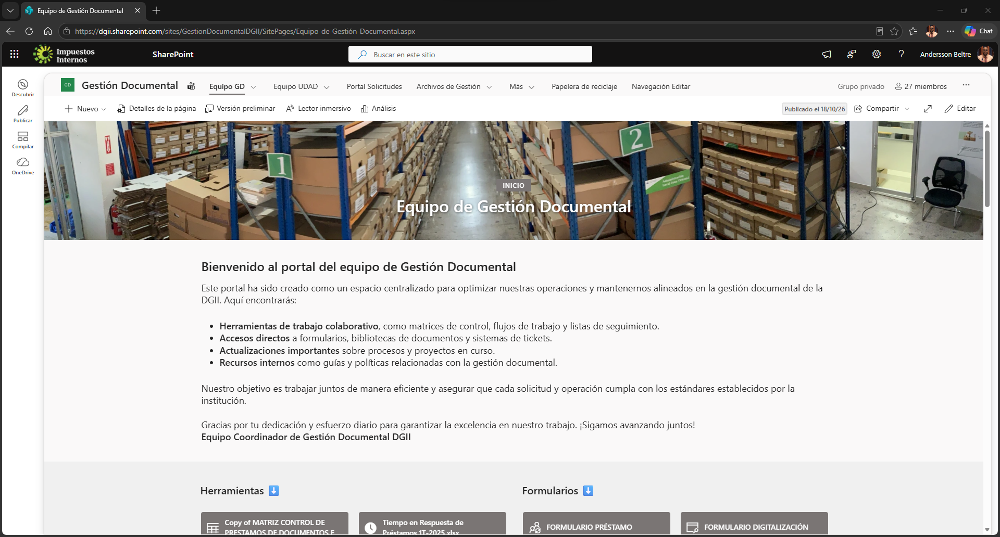

El sitio central funciona como capa común de navegación de SIGEDOCA. UDAD no se presenta como una aplicación aislada: sus accesos forman parte del portal institucional de Gestión Documental, junto con los demás procesos del sistema.

Los accesos específicos se agrupan bajo **Equipo UDAD**, reduciendo la exposición de listas técnicas y presentando al usuario acciones orientadas a tarea.

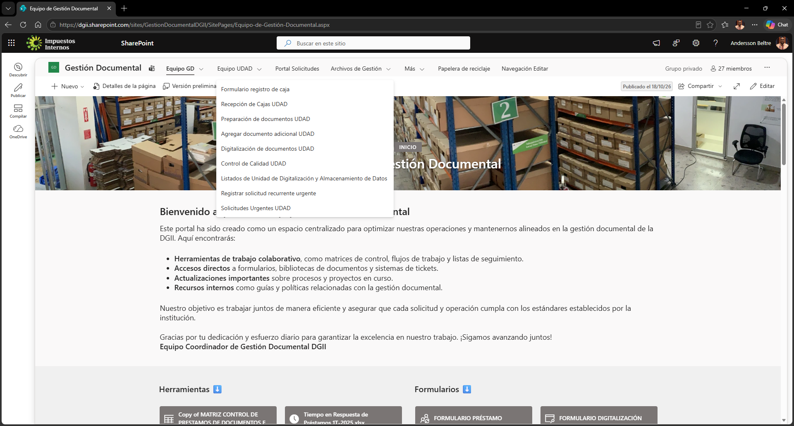

Desde esta navegación se accede a los procesos principales de recepción, preparación, digitalización, calidad, documentos adicionales, listados y solicitudes urgentes.

---

## 2. Formulario de registro de caja

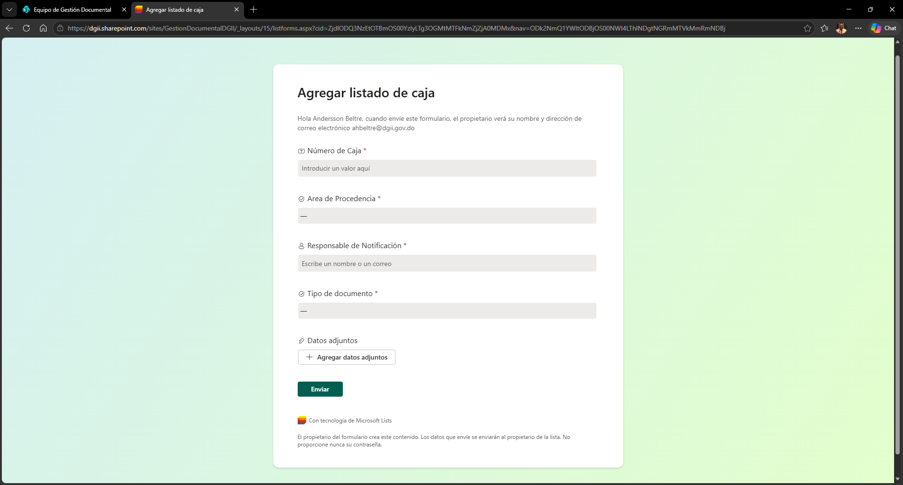

Este formulario constituye la entrada del proceso ordinario de UDAD y dispara el flujo **`UDAD - 01 Ingesta de Cajas v1`**.

El formulario recoge el contexto de la caja y recibe el Excel adjunto con los documentos que ingresarán al proceso. El flujo obtiene el adjunto desde el elemento de Microsoft Lists/SharePoint y, dado que Excel Online necesita operar sobre un archivo accesible como libro, crea una copia temporal para validarlo y leerlo.

### Caso de uso

1. Registrar una caja recibida.
2. Adjuntar el archivo `.xlsx` correspondiente.
3. Validar formato y contenido.
4. Crear/procesar los documentos de la caja.
5. Incorporarlos al circuito operacional de UDAD.
6. Registrar los eventos históricos pertinentes en `Datos de UDAD.xlsx`.

El formulario evita que el usuario tenga que crear manualmente decenas o cientos de elementos de SharePoint para una caja.

---

## 3. Recepción de cajas UDAD

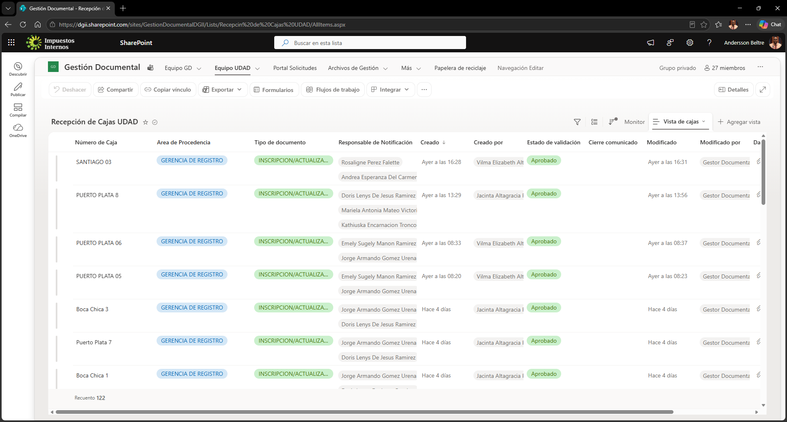

La lista de **Recepción de cajas UDAD** representa la capa de control por caja. Conserva el ingreso, procedencia, documentación asociada y estado necesario para controlar la recepción antes y durante su procesamiento.

La recepción es el punto de correlación entre la caja física y los documentos individuales que después recorren Preparación, Digitalización y Calidad.

### Relación con automatización

- `UDAD - 01 Ingesta de Cajas v1` parte de este contexto.
- `UDAD - 08 Reparación integral y cierre de cajas v1` vuelve a utilizar la identidad de caja para reconciliar el proceso y efectuar controles de cierre.
- La capa histórica equivalente se consolida en `tblCajas` de `Datos de UDAD.xlsx`.

### Caso no automatizado

La lista también cumple una función de consulta y supervisión: el personal puede revisar cajas recibidas, su procedencia y su estado sin ejecutar una automatización nueva.

---

## 4. Preparación de documentos UDAD

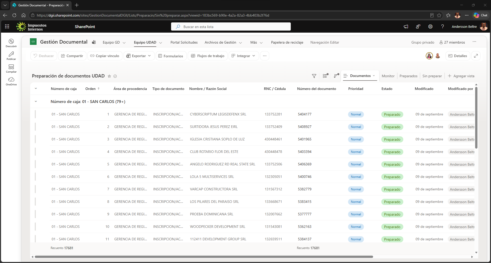

Preparación representa la primera etapa operacional a nivel de documento. Cada elemento mantiene la relación con caja, documento y orden, además del contexto tributario/documental necesario para las etapas siguientes.

El flujo **`UDAD - 02 Transición a Digitalización v1`** utiliza la finalización de esta etapa para llevar el documento al siguiente proceso. Los eventos históricos se reflejan en `tblPreparacion` de `Datos de UDAD.xlsx`.

### Corrección controlada de datos

La lista incorpora una columna con formato JSON avanzado que muestra un botón **Corregir datos** por elemento.

El JSON real se conserva en [`Corregir_Datos.json`](JSON/Corregir_Datos.json).

El botón usa `customRowAction` con `executeFlow` y enlaza el elemento seleccionado con un flujo manual. La configuración contiene el identificador:

`v1/Default-9871db45-5a09-4862-9f24-94a1120e5ed1/ca975483-91f1-4ad8-8988-defac7ea69b8`

Secuencia:

`Elemento de Preparación -> Corregir datos -> flujo de ejecución manual -> usuario de solo ejecución -> formulario Power Apps -> valores corregidos -> automatización de reparación -> actualización coordinada por No_Caja + Orden`

El botón es parte funcional del sistema. Eliminar la columna o perder su JSON rompe el punto de entrada de la corrección controlada aunque la lista conserve los demás campos.

---

## 5. Agregar documento adicional

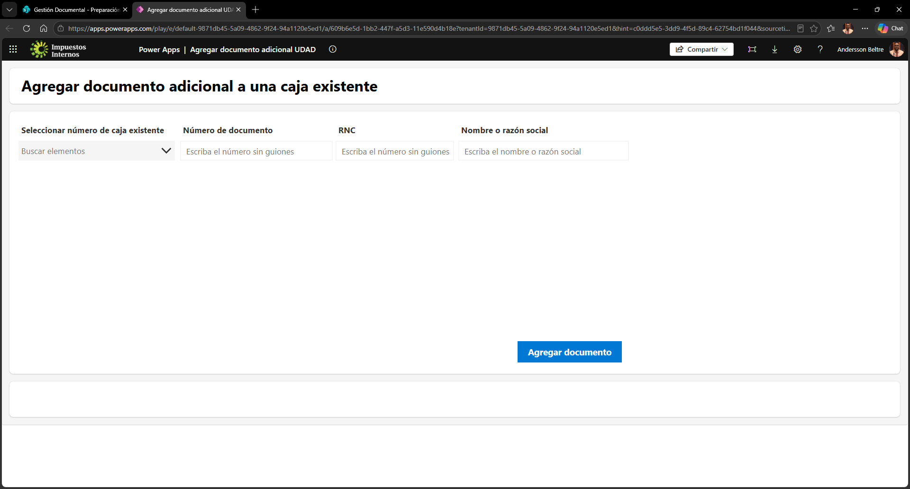

Esta interfaz cubre el caso en que debe incorporarse un documento después de la ingesta original de una caja.

El proceso se relaciona con **`UDAD - 06 Agregar documento adicional v1`** y evita tener que reconstruir o reprocesar la caja completa.

### Caso de uso

1. Identificar una caja existente.
2. Capturar el documento adicional y la información mínima requerida.
3. Calcular/asignar su orden dentro de la caja.
4. Incorporar el documento a las listas operacionales correspondientes.
5. Mantener la misma identidad de caja/documento utilizada por el histórico Excel y por los procesos posteriores.

Si la caja no puede reconciliarse con el histórico esperado, el flujo puede cancelar la incorporación para evitar introducir un documento aislado de su caja.

---

## 6. Digitalización de documentos UDAD

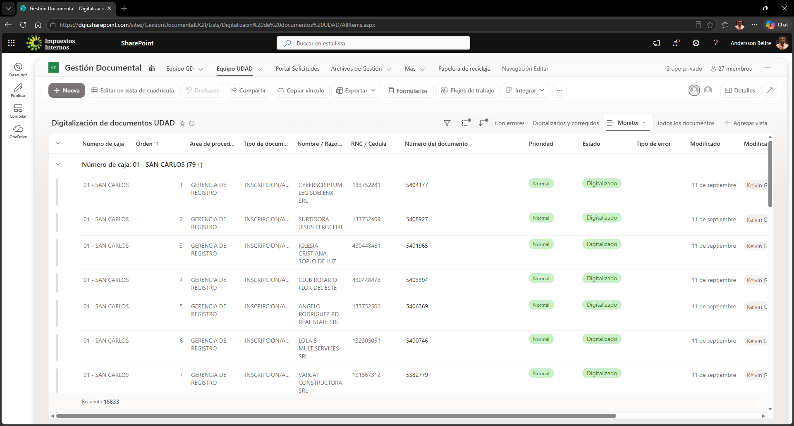

La lista de Digitalización recibe los documentos que completaron Preparación y deben convertirse o asociarse con su representación digital.

El flujo **`UDAD - 03 Transición a Control de Calidad v1`** conecta esta etapa con Control de Calidad.

`tblDigitalizacion` conserva la trazabilidad histórica, incluyendo usuario, duración, posibles errores y `Planner_Task_ID` cuando la gestión de tareas interviene.

### Caso no automatizado

La lista sirve como cola operacional: permite visualizar qué documentos se encuentran pendientes o en trabajo en Digitalización y revisar su contexto sin depender de Power BI.

---

## 7. Control de Calidad UDAD

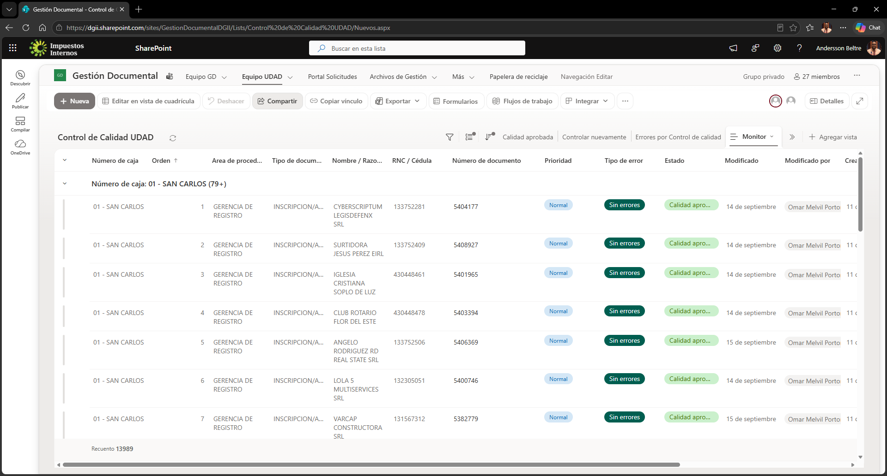

Control de Calidad valida el resultado de digitalización y determina si el documento puede considerarse aprobado o debe regresar a retrabajo.

El flujo **`UDAD - 04 Gestión de Calidad y Retrabajo v1`** administra esta lógica. La capa histórica equivalente es `tblCalidad`, que conserva rechazo, aprobación, tipos/cantidad de errores y si el evento corresponde a retrabajo.

### Regla arquitectónica importante

Un rechazo es un evento histórico, no necesariamente el resultado final. Si el documento se corrige y vuelve a Calidad, debe existir posteriormente su evento de aprobación. Esta secuencia es necesaria para reconstruir correctamente métricas y estado final.

---

## 8. Listados de UDAD

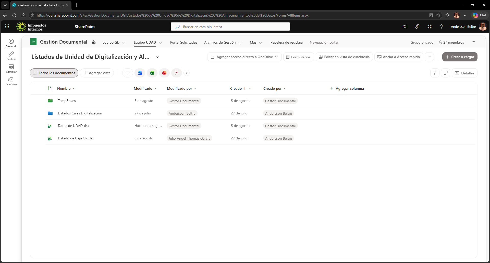

El menú de **Listados de Unidad de Digitalización y Almacenamiento de Datos** proporciona accesos de consulta y supervisión. Las capturas evidencian que la interfaz separa los procesos de ejecución de las vistas/listados usados para seguimiento.

### Caso de uso

- consultar trabajo por etapa;
- verificar cajas o documentos sin alterar su estado;
- facilitar supervisión operacional;
- navegar directamente a conjuntos de registros relevantes.

Estos accesos no necesitan disparar un flujo para aportar valor: forman parte de la capa de observabilidad diaria del módulo.

---

## 9. Solicitudes recurrentes urgentes

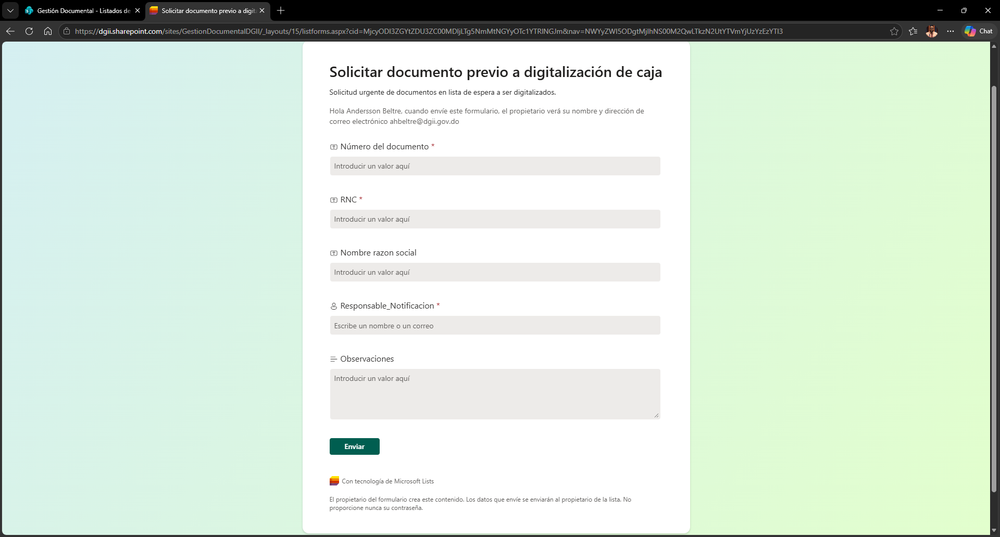

La interfaz **Registrar solicitud recurrente urgente** cubre trabajos que requieren priorización fuera del recorrido ordinario de producción.

El proceso se asocia con **`UDAD - 05 Gestión de Solicitudes Urgentes v1`**.

La solicitud urgente mantiene contexto suficiente para localizar el trabajo requerido y priorizarlo sin perder la trazabilidad dentro del módulo.

---

## 10. Solicitudes Urgentes UDAD

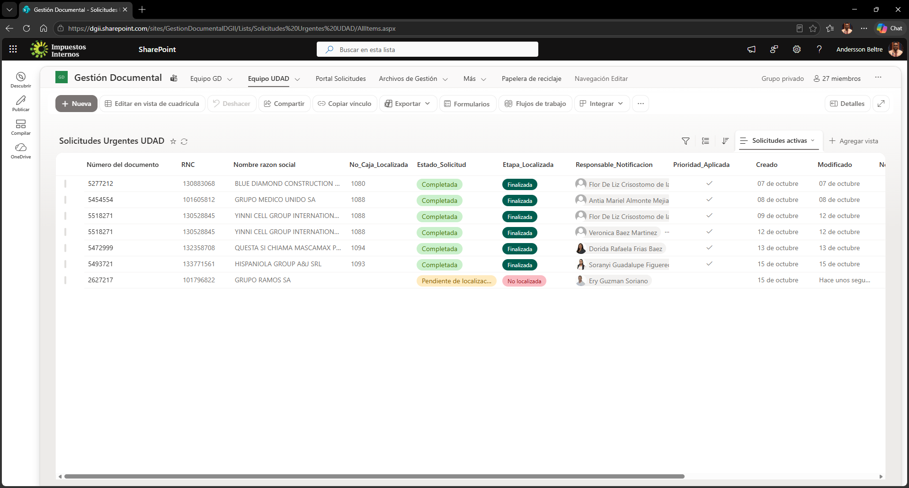

Esta lista permite consultar y gestionar las solicitudes urgentes registradas.

### Papel operacional

- centraliza los requerimientos prioritarios;
- expone estado y datos de seguimiento;
- permite al equipo diferenciar el trabajo urgente del flujo ordinario;
- sirve de origen/estado para la automatización de solicitudes urgentes.

Las capturas del documento muestran tanto la vista de la lista como pantallas de configuración y formularios asociados, lo que permite reconstruir posteriormente su esquema de columnas y comportamiento.

---

## 11. Relación SharePoint -> Excel -> Power BI

Las listas anteriores representan el **estado operacional vigente**. El histórico no depende solamente de conservar el estado actual de cada elemento.

Los flujos escriben eventos en:

- `tblPreparacion`
- `tblDigitalizacion`
- `tblCalidad`
- `tblCajas`

ubicadas en `../Excel_BD/Datos de UDAD.xlsx`.

Power BI utiliza ese histórico para el informe **Dashboard Gestión UDAD**, que presenta avance de cajas, preparación, digitalización, control, rechazos, alertas, pendientes y responsables.

La separación de responsabilidades queda así:

| Capa | Responsabilidad |
|---|---|
| SharePoint / Microsoft Lists | operación vigente y estado actual |
| Power Automate | transiciones, validaciones, notificaciones y escritura histórica |
| Power Apps | captura controlada en procesos especializados, como correcciones |
| Datos de UDAD.xlsx | histórico de eventos y base analítica |
| Power BI | métricas, seguimiento y visualización gerencial |

---

## 12. Componentes críticos para replicar UDAD

Al reconstruir este módulo no basta con crear listas del mismo nombre. Deben conservarse conjuntamente:

1. columnas y nombres internos;
2. tipos de columna y opciones de elección;
3. vistas utilizadas operacionalmente;
4. formularios y accesos desde el portal central;
5. JSON de columnas con acciones;
6. IDs/referencias de flujos usados por botones JSON;
7. permisos de ejecución y conexiones correspondientes;
8. correspondencia entre listas y tablas históricas Excel;
9. Power App del proceso de corrección;
10. modelo Power BI que consume el histórico.

La interfaz SharePoint es, en consecuencia, la **capa operacional visible de una arquitectura mayor**, no un conjunto independiente de listas.

## Fuente visual

Las imágenes de este README fueron extraídas de la documentación `INTERFAZ VISUAL DE UDAD.docx`, que registra la interfaz productiva observada del módulo. Las imágenes sirven como referencia visual para comprensión y reconstrucción de la experiencia de usuario; la configuración reutilizable se conserva por separado cuando existe en formato estructurado, como el JSON de `Corregir datos`.
